<div align="center">

# 校园集市 · Campus Market

**让闲置物品在校园里继续被使用。**

Java 后端 × uni-app 多端前端 × Electron 桌面端的校园二手交易项目


[项目展示](#项目展示) · [技术实现](#我在项目里重点练习了什么) · [本地运行](docs/GETTING_STARTED.md) · [验收记录](docs/VERIFICATION.md) · [源码导航](docs/TECH_STACK.md)

[](https://github.com/StewardAndrecher/-/actions/workflows/backend-quick.yml)
[](https://github.com/StewardAndrecher/-/actions/workflows/client-desktop-quick.yml)
[](https://github.com/StewardAndrecher/-/actions/workflows/release-quality.yml)

</div>

## 项目介绍

这是我在学习 Java 和全栈开发过程中持续完善的一个项目。选校园二手交易这个场景，是因为教材、数码和宿舍用品的流转比较贴近大学生活，也能把前端页面、后端接口和数据库设计串起来。

我从商品展示和发布开始，逐步补上账号、收藏、买卖沟通、订单、退款售后和管理功能。后来遇到重复提交、订单超时、消息重试、缓存一致性等问题，又加入了 Redis、RabbitMQ、事务和自动化测试。这个仓库保留了前后端源码、数据库迁移和运行工具，可以沿着一笔交易去看每一层是怎样配合的。

目前定位是**可在本地运行和演示的全栈学习项目**。订单使用模拟付款；真实微信支付、生产服务器和公网域名尚未接入。下面展示的是已经实现的页面和业务流程。

## 项目展示

截图来自本地运行或隔离演示环境，账号、商品及订单为演示数据；商品封面部分使用项目自制的分类占位插画。页面读取真实后端接口，不是设计稿。

### Web 首页

响应式商品列表，支持校区、分类、搜索、排序和收藏。发布面板默认收起，点击入口后展开，快捷浏览使用平滑滚动。

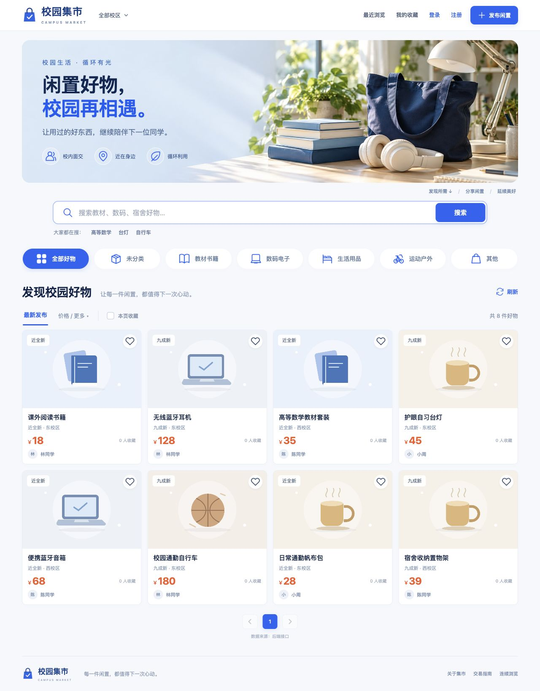

### 手机布局

同一套 uni-app 页面在窄屏下使用双列商品卡片和底部导航。以下为 **H5 响应式页面**；微信小程序和原生 App 的验收范围见下方说明。

<table>
  <tr>
    <td align="center">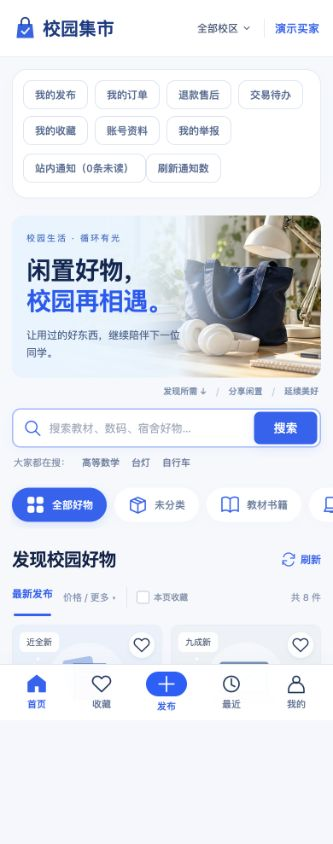<br />首页与搜索</td>
    <td align="center">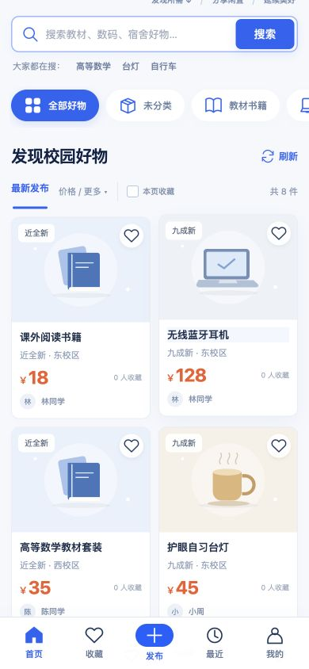<br />商品列表与底部导航</td>
  </tr>
</table>

### 商品与交易

商品详情包含相册、成色、校区、交接地点和卖家资料；下单后保留下单快照与操作时间线。

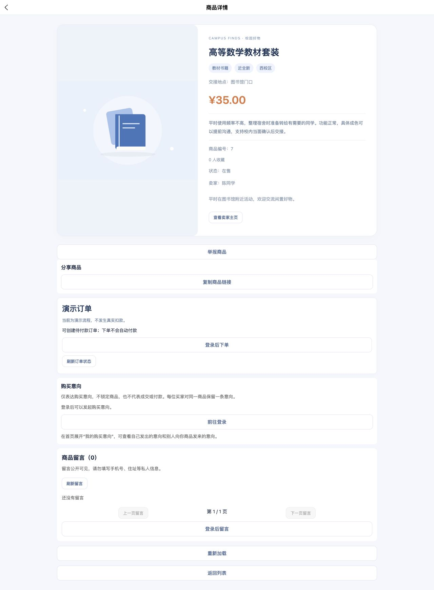

<details>
<summary>查看订单详情与操作时间线</summary>

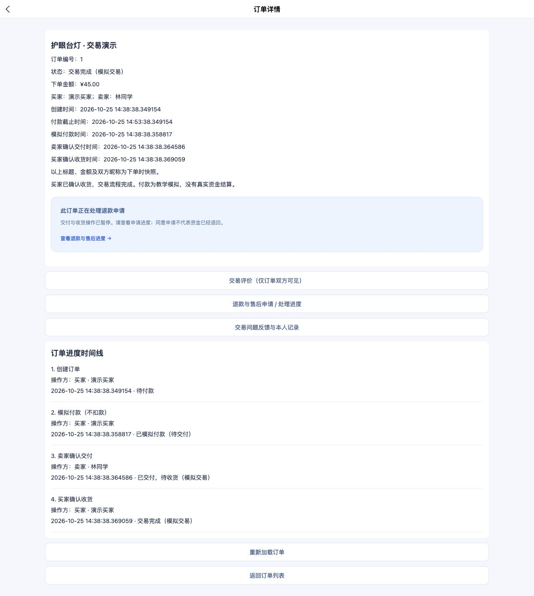

</details>

### 退款与售后

买家提交原因和说明，卖家答复，页面保留处理记录。售后状态与订单履约状态分开保存；演示订单中“同意申请”不会被显示成“退款到账”。

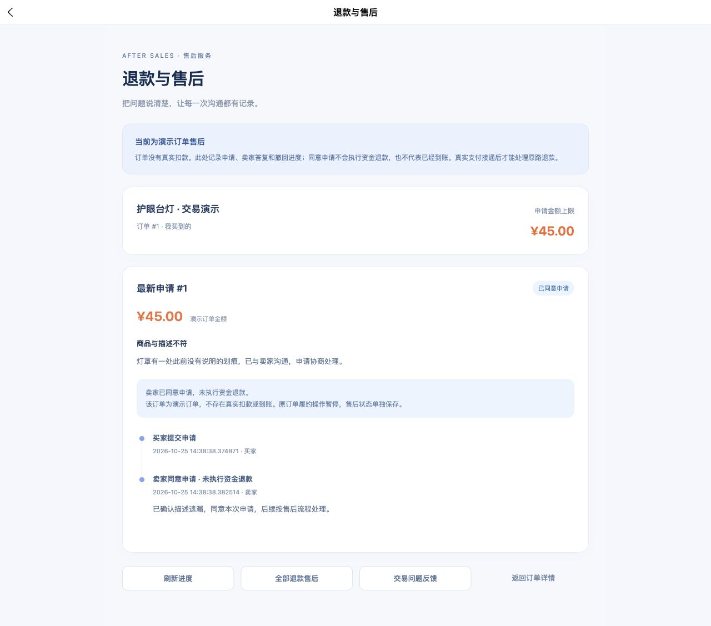

<details>
<summary>更多页面：图片空间、内容治理、发布检查和 Mac 客户端</summary>

**图片空间**：查看配额、引用状态与回收站，已引用的图片不能直接删除。

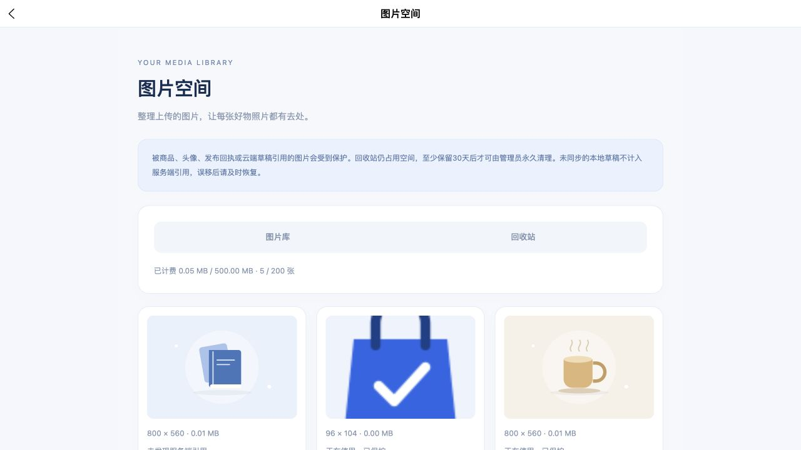

**内容与滥用治理**：管理员查看限制原因、期限和处理记录，配合举报与商品复核流程。

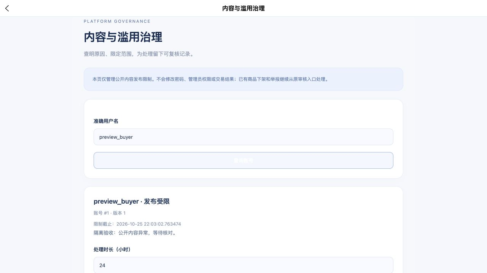

**发布质量检查**：提交前检查资料完整性，后端仍独立校验权限、字段和内容规则。

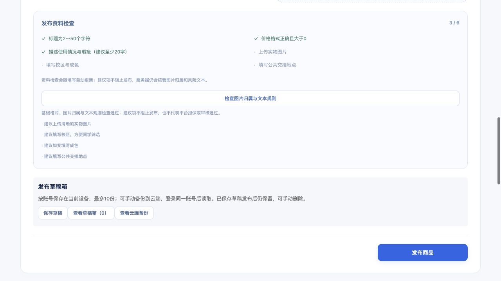

**Mac 客户端**：Electron 加载同源 Web 产物，复用已有业务页面和接口。

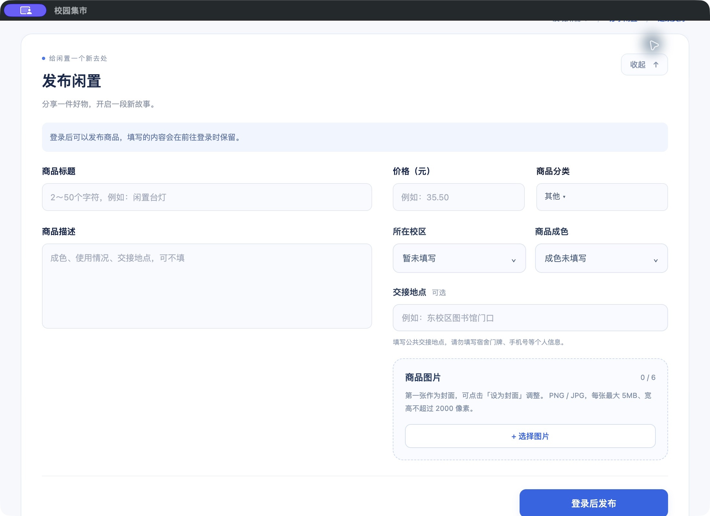

**消息与监控**：订单超时消息投递、消费和积压情况可在本地监控面板中查看。

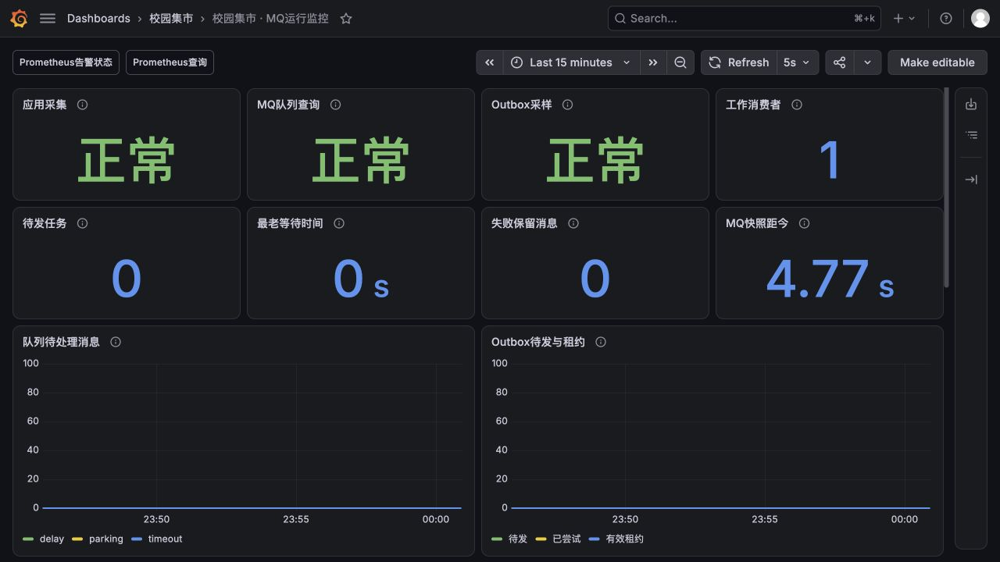

</details>

## 已实现的功能

| 使用场景 | 主要功能 |
| --- | --- |
| 账号与个人资料 | 注册登录、BCrypt 密码哈希、会话列表与撤销、改密、恢复码、邮箱绑定与验证码找回流程、昵称/头像/校区/简介 |
| 发现与发布 | 分类和校区筛选、关键词搜索、排序、连续浏览、收藏、浏览历史、多图商品、成色与交接地点、本地及云端草稿、发布前检查 |
| 买卖沟通 | 公开留言、购买意向、意向内私信、撤回、未读提示与站内通知；私信通过 HTTP 刷新获取 |
| 交易与售后 | 幂等下单、15 分钟未付款关闭、模拟付款、交付/收货、订单快照与时间线、评价、退款申请及卖家处理、交易问题反馈 |
| 管理与治理 | ADMIN 授权、商品巡查与复核、举报处理、交易问题处理、账号发布限制、操作审计 |
| 图片与运维 | 图片配额及引用保护、回收站、数据库版本迁移、SQL 与图片联合备份/恢复、历史数据清理预览、发布质量检查 |

## 技术栈

| 部分 | 技术与用途 |
| --- | --- |
| 前端 | **uni-app、Vue 3、JavaScript、CSS**：Web / 微信小程序 / App 共用页面，按平台处理连接地址和交互差异 |
| 后端 | **Java 17、Spring Boot 4.1.1、Spring MVC、Spring JDBC**：REST 接口、参数校验、事务与数据访问 |
| 数据库 | **MySQL、InnoDB、Flyway**：版本迁移、外键/唯一约束、行锁、复合索引、游标分页 |
| 缓存与保护 | **Redis、Lua**：商品详情版本缓存；独立实例处理登录与注册频率限制 |
| 消息 | **RabbitMQ、Spring AMQP**：订单超时、站内通知、Outbox、发布确认、重试与幂等消费 |
| 桌面端 | **Electron**：复用 Web 构建，本地静态服务、窗口隔离与请求白名单 |
| 工程与观测 | **JUnit、Node Test Runner、Python 工具、GitHub Actions、OpenAPI、Prometheus / Grafana / Alertmanager** |

## 我在项目里重点练习了什么

- **让一笔订单有明确的状态和边界。** 下单时校验商品版本并锁定相关记录，使用请求幂等键和数据库约束处理重复提交；交易状态变化与事件记录在同一事务完成。[订单实现](campus-market-server/src/main/java/com/campus/market/order/OrderService.java)
- **让异步任务失败后还能继续处理。** 业务操作与 Outbox 同事务落库，再由独立投递器发消息；结合发布确认、租约、重试、幂等消费和数据库扫描补偿处理超时关单。[订单 MQ 实现](campus-market-server/src/main/java/com/campus/market/order/mq)
- **理解缓存与数据库的职责。** 商品详情按版本缓存，事务提交后再失效；数据库决定商品是否可见。登录保护与可淘汰缓存分实例，避免限流记录被缓存淘汰策略影响。[缓存实现](campus-market-server/src/main/java/com/campus/market/product/ProductDetailCache.java) · [登录保护](campus-market-server/src/main/java/com/campus/market/auth/LoginRateLimiter.java)
- **把权限与用户身份放在服务端检查。** 使用随机会话令牌，校验商品归属、订单双方和管理员角色；页面隐藏按钮之外，接口仍检查越权、版本冲突和重复请求。[账号与会话](campus-market-server/src/main/java/com/campus/market/auth)
- **把数据恢复也作为功能来验证。** 数据库与图片一起备份，使用摘要核验并恢复到全新隔离库；运行、迁移、备份和维护账号分别授权。资金数据保留证据和借贷分录，模拟与真实账簿分开。[数据库设计与演练](campus-market-server/docs/database-maturity.md)
- **先看执行计划再加索引。** 在 10 万商品、10 万订单的合成数据上比较执行计划，为买家/卖家状态分页补复合索引。关键词包含查询仍有扫描成本，后续需要继续优化。[本地 SQL 测量记录](docs/VERIFICATION.md#数据库演练与查询测量)

## 项目结构

```text
campus-market-client/    uni-app 页面、组件、接口、状态处理与前端测试
campus-market-server/    Spring Boot 服务、Flyway 迁移、集成测试与运维工具
campus-market-desktop/   Electron 主进程、Web 产物同步与桌面测试
.github/workflows/      后端快速检查、前端/桌面检查、完整后端回归
scripts/                仓库级前端检查入口与新库 SQL 初始化参考
docs/                  运行说明、技术导航、验收摘要和真实截图
```

[查看架构图和源码入口 →](docs/TECH_STACK.md)

## 本地运行

1. 克隆仓库，准备 Java 17、Maven、MySQL、Redis 和 HBuilderX。
2. 建立空的开发数据库，配置本机凭据并通过 Flyway 初始化；启动两个独立 Redis 实例和后端。
3. 在 HBuilderX 导入 `campus-market-client`，运行到浏览器；小程序需填写自己的 AppID。
4. 可选启动 RabbitMQ、邮件服务与 Electron，查看相应场景。

**完整步骤、配置变量与验证命令：[GETTING_STARTED.md](docs/GETTING_STARTED.md)。** 仓库不提供真实账号、私有数据库和支付密钥。

## 验证与当前边界

本地验证记录更新于 **2026-10-25**。后端完整测试覆盖 109 类、1973 项；最近一次记录由完整执行与受影响的 35 项通知测试重跑合并确认，详细过程没有省略。前端与桌面逻辑检查共 1105 项，另外保留后端快速检查、工具测试、跨端编译和数据库恢复演练记录。**具体范围和限制见 [验收记录](docs/VERIFICATION.md)**；上方 CI 徽章展示 GitHub 上实际运行的状态。

| 项目 | 当前范围 |
| --- | --- |
| Web | 本地浏览器真实页面与接口验收；支持电脑和手机宽度 |
| 微信小程序 | 已编译并完成部分开发者工具场景验收；当前 50 个页面没有逐页做真机验收，未上线发布 |
| 原生 App | 已通过 App 资源编译与静态检查；未完成 Android / iOS 真机和 APK / IPA 发布验收 |
| 桌面端 | 本地 Mac ARM64 运行及打包验收；未签名、公证，未验收 Windows / Linux 安装包 |
| 支付与售后 | 已实现模拟交易、售后流程和支付数据模型；未接真实支付、原路退款与卖家结算 |
| 邮件与微信身份 | 邮箱流程与 SMTP 适配器已实现，真实邮件服务未配置；微信身份关联模型已建，OAuth 未接入 |
| 存储与部署 | 图片存本地；已提供生产配置、备份定时模板与隔离演练，正式服务器、定时任务、异地备份尚未部署 |

接下来会优先完善实际部署和运维验证，再按正式商户条件接入真实支付，继续补齐移动端真机测试与图片对象存储。
