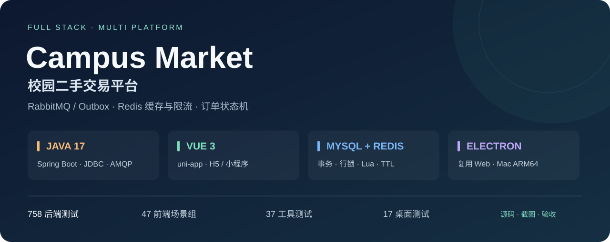
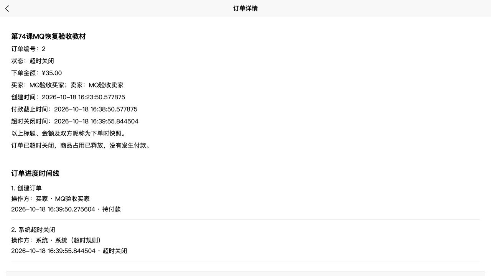
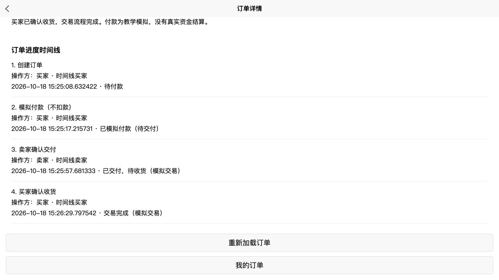
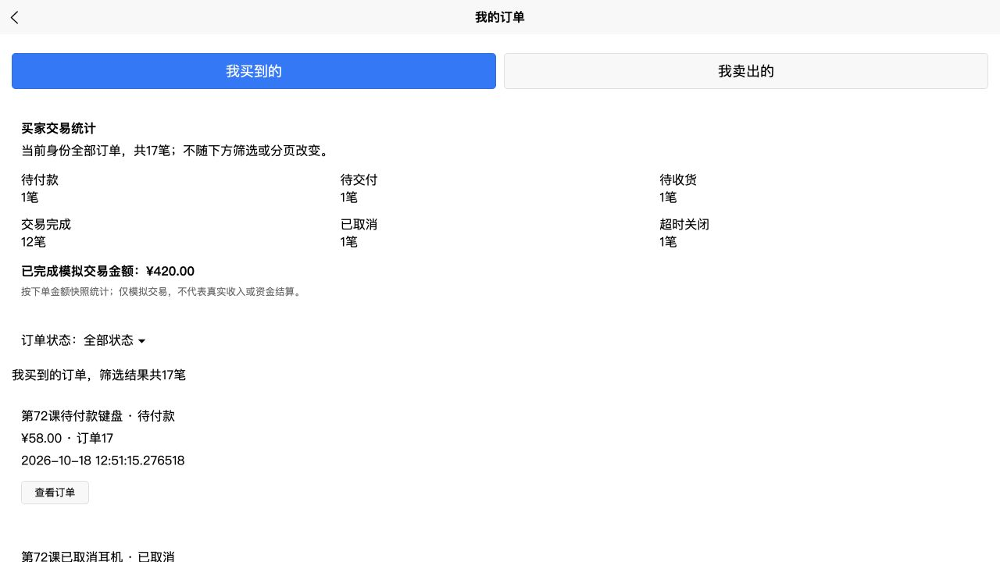
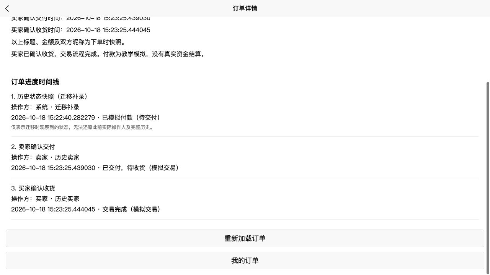
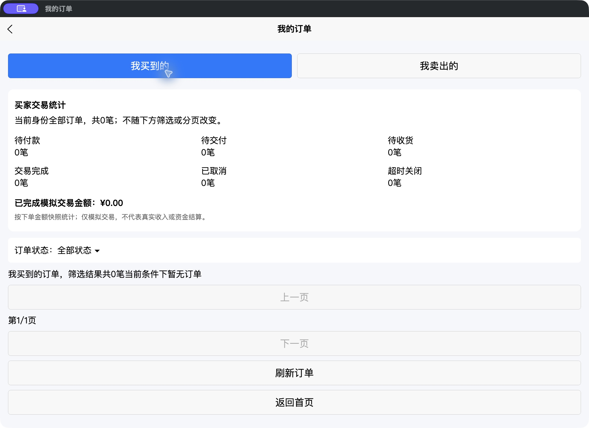
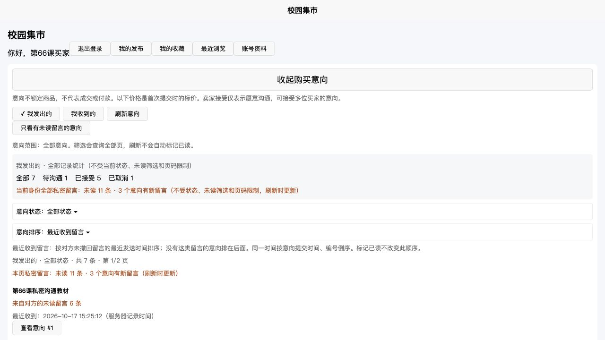
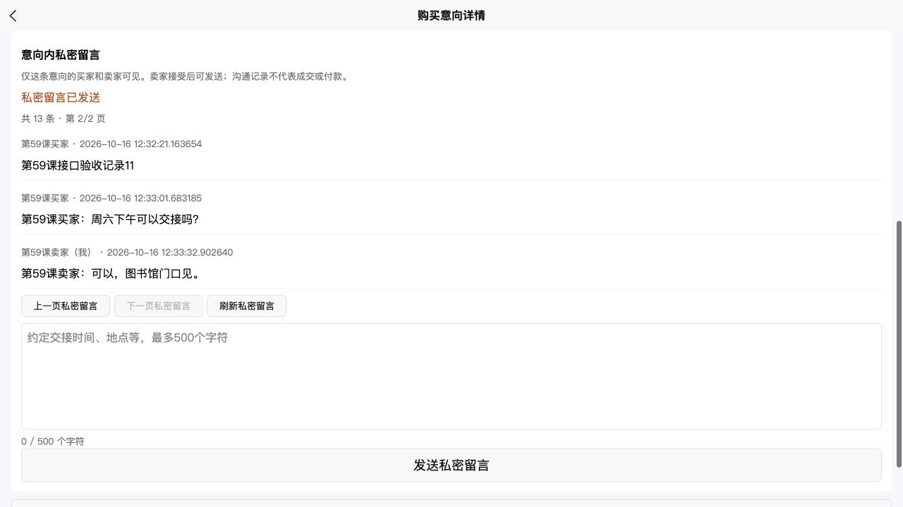
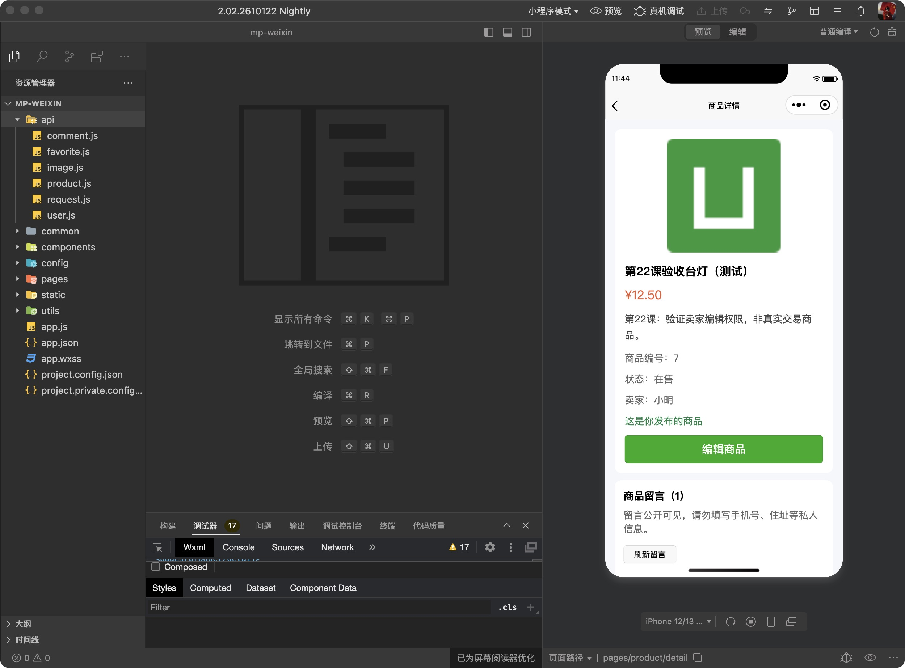

# Campus Market · 校园二手交易平台



**Java 17 / Spring Boot + MySQL + Redis + RabbitMQ + Vue 3 / uni-app + Electron。** 面向校园闲置交易，实现商品管理、买卖沟通、订单流转和进度记录，复用同一套前端业务代码覆盖Web、微信小程序、App资源与Mac桌面端。

[技术栈](#tech-stack) · [工程亮点](#engineering) · [实际截图](#screenshots) · [启动指南](docs/GETTING_STARTED.md) · [架构与源码索引](docs/TECH_STACK.md) · [测试与验收](docs/VERIFICATION.md)

仓库包含截至第74课的完整源码、25份有序建库脚本、测试入口和实际验收截图。业务服务目前在本机运行，GitHub链接用于源码与项目展示。

<a id="tech-stack"></a>

## 技术栈

| 层次 | 实际使用 | 项目中的职责 |
|---|---|---|
| 共享前端 | Vue 3、Composition API、JavaScript、uni-app | 共享页面与组件，多端条件编译、统一请求、内存会话与异步响应保护 |
| 后端 | Java 17、Spring Boot 4.1.1、Spring MVC | REST API，Controller / Service / Repository分层，参数、权限及异常处理 |
| 数据库 | MySQL / InnoDB、Spring JDBC / JdbcTemplate | 参数化SQL、事务与行锁、版本条件更新、唯一约束、聚合与稳定分页 |
| Redis | Spring Data Redis、Lettuce、Lua | 商品正文版本缓存、TTL抖动、提交后失效；独立实例的登录限流与并发占位 |
| 消息队列 | RabbitMQ、Spring AMQP、Quorum、TTL / DLX | 订单延迟关闭、事务Outbox、确认与退回检查、租约重试、幂等消费 |
| 身份认证 | BCrypt、随机Bearer会话、SHA-256摘要 | 密码哈希、会话过期/退出，按当前账号校验资源归属 |
| 桌面 | Electron 44.7.0、Node.js、Electron Packager | 复用H5，Mac ARM64打包、回环静态服务、窗口和请求权限限制 |
| 验证与交付 | JUnit、MockMvc、Mockito、Node Test Runner、Maven、HBuilderX | 临时MySQL/Redis/RabbitMQ集成测试、跨端构建、源码/产物SHA-256清单 |

版本、设计与代码入口见[技术栈详解](docs/TECH_STACK.md)。

## 业务模块

| 模块 | 已实现能力 |
|---|---|
| 账号与登录保护 | 注册、登录、退出、昵称修改；来源IP和账号维度Redis限流，429/503恢复提示 |
| 商品与发现 | 发布/封面上传、编辑、在售/下架/已售、分类、搜索、排序、分页、收藏、浏览记录、卖家主页 |
| 发布草稿 | 按账号保存本机草稿、云端备份与恢复、搜索/分类/排序 |
| 公开与私密沟通 | 商品留言；购买意向发起/取消/接受；意向内双方留言、幂等发送、撤回、阅读进度及未读聚合 |
| 正式订单流程 | 版本校验与下单幂等、有效订单唯一占用、15分钟待付款超时、取消释放、模拟付款、卖家交付、买家收货 |
| 订单查询 | 我买到的/我卖出的、六种状态筛选、分页、角色全量统计、已完成模拟交易金额 |
| MQ超时处理 | 同事务保存待发任务，延迟队列触发关闭；断线自动重试、失败消息保留、数据库扫描补偿 |
| 进度时间线 | 状态与记录同事务、操作人/昵称快照、系统超时记录、参与者私有查询、历史状态快照迁移 |

**付款目前为教学模拟，不发生真实扣款或资金结算。** 购买意向只表示沟通意愿，订单独立承担商品占用和交易状态；私密留言采用HTTP刷新。

<a id="engineering"></a>

## 工程亮点

1. **订单并发与幂等。** 下单携带商品版本和提交标识，事务按商品→订单顺序加锁；条件更新与唯一约束保证商品有效订单占用。重复付款、交付和收货返回已有结果，不重复变更或记录。
2. **状态与记录同事务。** 创建、付款、交付、收货、取消、超时均追加操作记录，任一步失败一起回滚。订单和时间线在同一只读快照中读取；历史订单只补明确标注的状态快照。
3. **RabbitMQ与事务Outbox。** 订单、操作记录和待发任务同事务提交，后台使用租约投递持久消息，核对Publisher Confirm和Mandatory Return。Quorum队列通过TTL / DLX触发超时检查，幂等消费防止重复变更；有限重试后进入parking，数据库扫描继续补偿。
4. **Redis缓存一致性与降级。** 缓存键包含商品ID/版本，提交后删除旧版本键，TTL附加随机值。每次仍查数据库当前状态、版本及动态信息；Redis失败时回退数据库，未把缓存命中宣传为零SQL。
5. **Redis Lua登录保护。** 来源预算、账号预算、在途占位与TTL一次脚本执行；成功核验按票据清理，避免并发请求越过额度。保护实例与可淘汰缓存实例分离，保护服务故障返回503。
6. **权限与异步响应保护。** 操作身份由服务端会话确定，私密记录仅参与者可读；前端在账号切换、页面隐藏或卸载后使旧请求失效。写入成功但随后读取失败时保留已确认结果。
7. **统计与跨端交付。** 状态过滤在SQL分页前执行，角色全量统计和列表共享事务快照；uni-app三端资源与Mac内嵌H5均生成并校验源码/产物哈希。

[查看架构、实现边界及对应源码](docs/TECH_STACK.md#source-map)。

<a id="screenshots"></a>

## 实际截图

截图来自本机或隔离验收环境，订单、账号与留言用于开发演示。范围见[验收说明](docs/VERIFICATION.md)。

### RabbitMQ故障恢复后的订单超时关闭



隔离环境停止MQ时下单返回201；恢复后Outbox自动重试，关闭到期待付款订单并释放商品占用，系统事件只记一次。验收关闭了数据库扫描，使用200毫秒TTL及测试订单时间调整；正常规则仍为15分钟。

### 订单进度时间线：创建 → 模拟付款 → 交付 → 收货



### 状态筛选与当前角色的全量交易统计



<details>
<summary>展开：历史订单迁移、Mac桌面、双方留言与小程序截图</summary>

**旧订单仅补历史状态快照，迁移后的操作继续追加：**



**新版Mac应用实际启动、登录并读取空订单页：**



**购买意向、未读总览与最近收到时间（第66课）：**



**意向内双方留言：**



**微信开发者工具历史详情页验收（第29课）：** 当前源码已重新完成小程序编译和结构检查，未声称所有最新业务都重新做过模拟器验收。



</details>

## 运行与验证

按[启动指南](docs/GETTING_STARTED.md)建立全新MySQL数据库、启动两个独立Redis实例；启用MQ时启动项目RabbitMQ节点，在IDEA运行后端，再用HBuilderX运行前端。仓库AppID和局域网IP是示例值。

| 验证 | 当前通过记录 | 仓库复查入口 |
|---|---:|---|
| 后端集成与回归 | 758项，50个测试类（新增34项MQ）；0失败/错误/跳过 | `python3 scripts/test_backend.py` |
| 前端状态、接口与平台 | 47组 | `python3 scripts/test_frontend.py` |
| 构建、存储与网络工具 | 37项 | 上述前端入口一并执行 |
| 桌面运行规则 | 17项 | 桌面目录安装依赖后 `npm test` |

后端验证创建临时MySQL、两个临时Redis和独立RabbitMQ节点；本课后端与MQ网页重新验收，前端47组及跨端构建记录来自源码未改的第73课。前端复查入口可重新构建三端资源。环境和验证边界见[测试说明](docs/VERIFICATION.md)。

| 终端 | 已验证范围 |
|---|---|
| Web | 当前业务HTTP和浏览器操作；最新MQ超时关闭、订单四步时间线、历史快照与统计 |
| 微信小程序 | 当前源码编译、14页和组件结构检查；历史页面有开发者工具验收 |
| Mac ARM64 | 新包实际启动/登录/空订单页检查，53个Web资源与源码构建一致 |
| Android / iOS | App资源编译通过；尚未完成APK/IPA与手机验收 |

## 仓库结构

```text
campus-market-client/     uni-app页面、组件、API及构建工具
campus-market-server/     Spring Boot、Redis/Lua、RabbitMQ、SQL与JUnit测试
campus-market-desktop/    Electron主进程、静态服务与桌面测试
scripts/                 全新建库、隔离后端及前端验证入口
docs/                    架构、启动指南、验收与实际截图
```

当前尚未接入真实支付、退款售后、WebSocket实时推送、线上部署或大规模性能压测。操作记录为应用层只追加，数据库管理员仍可修改，删除订单会级联删除记录；未将其描述为不可篡改存证。

消息采用至少一次投递与幂等业务效果；当前RabbitMQ为本机单节点，未验收集群高可用，也没有吞吐提升倍数声明。

源码和结构SQL公开；真实数据库、会话、MQ凭证/Cookie/磁盘消息、图片上传目录、IDE配置、依赖、运行日志及安装包保留本机。
