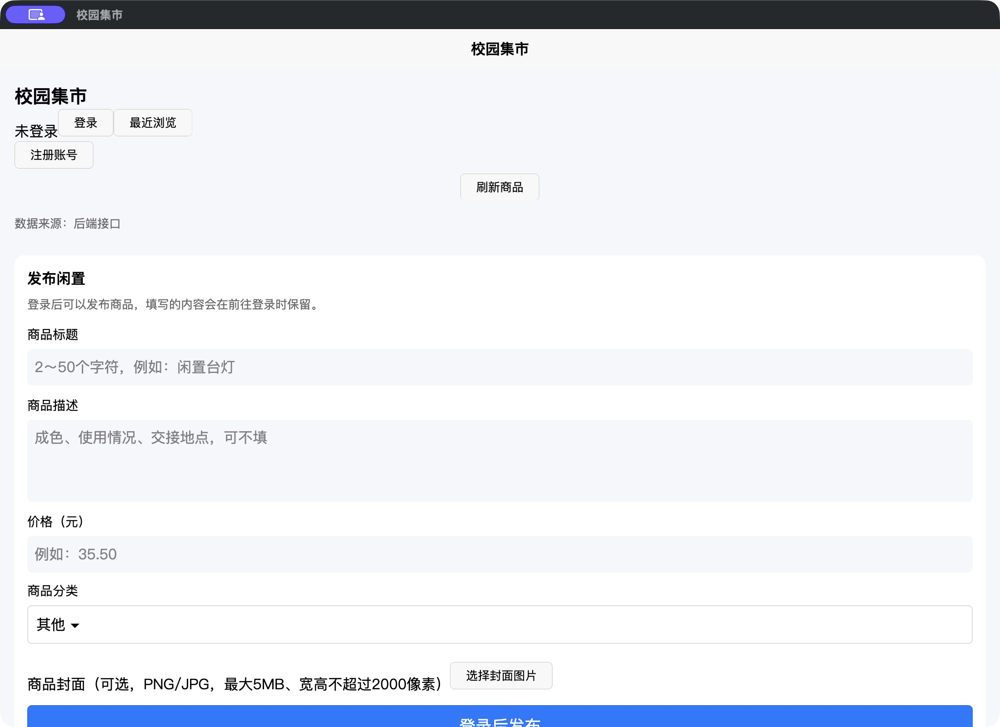
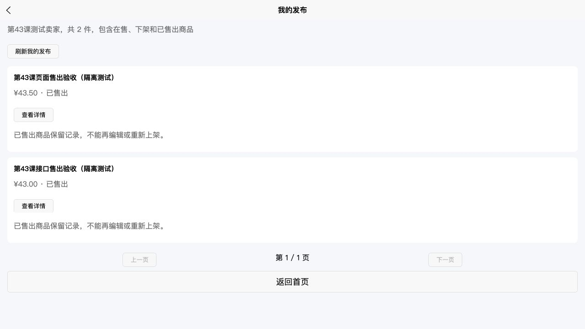
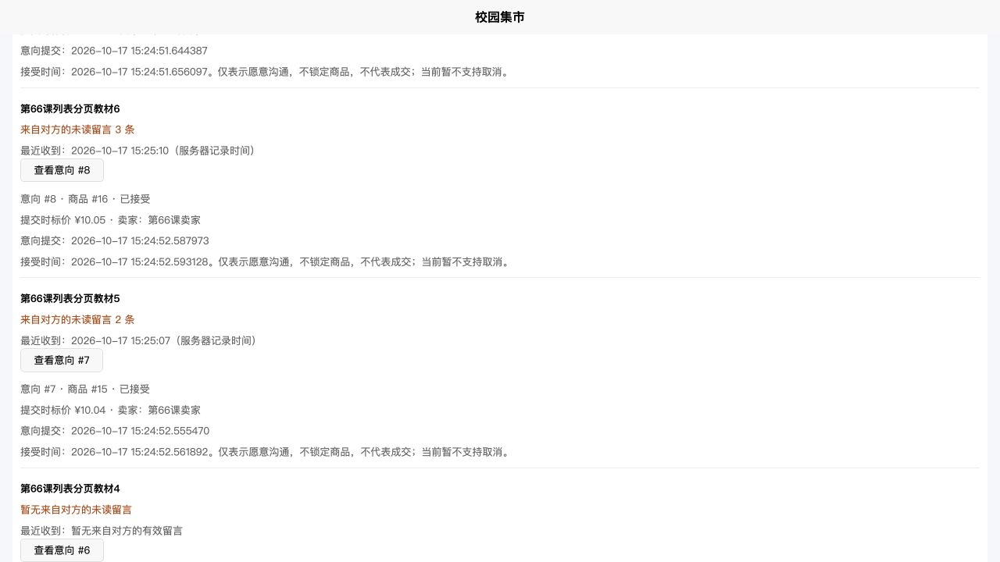

# Campus Market · 校园二手交易平台


**Java / Spring Boot + Vue 3 / uni-app + MySQL + Electron。** 围绕校园闲置流转，实现商品发布、个人收藏、购买意向和双方留言；一套前端复用到 Web、微信小程序、App资源与Mac桌面端。

[技术栈](#tech-stack) · [实现亮点](#engineering) · [实际截图](#screenshots) · [本地启动](docs/GETTING_STARTED.md) · [架构与技术说明](docs/TECH_STACK.md) · [测试与验收](docs/VERIFICATION.md)

本仓库包含截至第66课的完整实现、建库脚本、测试和验收截图。GitHub链接用于源码与项目展示；业务服务目前在本机运行。

<a id="tech-stack"></a>

## 技术栈

| 层次 | 实际使用 | 在项目中的职责 |
|---|---|---|
| 前端 | Vue 3、Composition API、JavaScript、uni-app | 共享页面与组件，Web/微信/App条件编译，统一请求与会话管理 |
| 后端 | Java 17、Spring Boot 4.1.1、Spring MVC | REST API、Controller/Service/Repository分层、统一异常响应 |
| 数据访问 | Spring JDBC / JdbcTemplate、MySQL / InnoDB | 参数化SQL、事务、行锁、版本条件更新、唯一约束、分组聚合 |
| 身份认证 | BCrypt、随机Bearer会话、SHA-256摘要 | 密码哈希；会话过期与退出；按登录账号校验资源权限 |
| 桌面客户端 | Electron 44.7.0、Node.js、Electron Packager | 复用H5资源，Mac ARM64打包，本机静态服务与窗口/权限限制 |
| 测试 | JUnit Jupiter、MockMvc、Mockito、Node Test Runner | 独立MySQL集成测试、前端状态检查、构建与桌面规则验证 |
| 构建与交付 | Maven、HBuilderX、Git、SHA-256资源清单 | 三端构建校验、源码/产物一致性检查、可复现验证脚本 |

版本与源码位置见 [技术栈详解](docs/TECH_STACK.md)。

## 业务模块

| 模块 | 已实现能力 |
|---|---|
| 账号 | 注册、登录、过期/退出、昵称修改、个人数据隔离 |
| 商品 | 发布与封面上传、编辑、在售/下架/已售、分类、关键词、排序与分页 |
| 发现与管理 | 收藏、浏览记录、卖家主页、个人发布筛选与状态统计 |
| 发布草稿 | 按账号保存本机草稿、云端备份、搜索/分类/排序及恢复 |
| 公开留言 | 分页发表、卖家标记、作者撤回、同次提交幂等 |
| 购买意向 | 发起、取消、卖家接受、详情、买卖身份与状态筛选、完整历史 |
| 意向内留言 | 参与方可见、发送幂等、作者撤回、个人已读进度、分页 |
| 未读与时间 | 本页未读、身份全局总览、只看未读、最近收到排序与时间显示 |

意向接受表示愿意沟通；支付、成交订单和库存锁定尚未实现。私密留言通过HTTP刷新获取，尚未实现WebSocket推送。

<a id="engineering"></a>

## 实现亮点

1. **并发修改控制。** 商品版本参与条件更新，旧页面修改冲突返回409；涉及购买意向的操作在事务中锁定必要记录，结合唯一约束维护业务状态。
2. **幂等写入与手动恢复。** 发布和留言携带提交标识，同次请求重试返回原结果；相同标识改内容返回冲突。撤回保留记录，避免重试把已撤回内容重新展示。
3. **账号与资源权限隔离。** 服务端从会话取得身份，校验卖家、买家和作者；意向内留言只对参与者开放。前端对Token、账号和页面状态变化使旧响应失效。
4. **聚合查询与稳定分页。** SQL完成过滤、排序后再分页；全局未读、本页计数各有明确范围。当前页最近接收时间一次批量查询，避免逐条访问数据库。
5. **可复查的跨端构建。** 共享uni-app业务代码，按平台处理服务器地址、图片和分享；构建生成源码/产物哈希清单，并检查小程序页面、组件及样式作用域。
6. **桌面运行边界。** Electron渲染进程禁用Node访问，启用上下文隔离与沙箱；本机服务绑定回环地址，检查路径、Host、CSP、导航及请求目标。

对应源码与设计说明见 [实现索引](docs/TECH_STACK.md#source-map)。

<a id="screenshots"></a>

## 实际截图

截图来自本机或隔离测试环境，账号、商品、留言均用于开发验收。不同截图对应功能完成时的版本，具体范围见 [验收记录](docs/VERIFICATION.md)。

### Web：购买意向、未读总览与最近收到时间


### Mac：复用同一套页面的原生桌面应用



<details>
<summary>展开：双方留言、商品已售、接收时间与微信开发者工具截图</summary>

**意向内双方留言：**


**个人商品的已售状态：**



**收到时间、空会话与记录对应：**



**微信开发者工具历史功能验收（第29课）：** 当前版本的小程序编译与结构检查通过，未声称所有最新业务都在模拟器重新验收。


</details>

## 运行与验证

先按 [启动指南](docs/GETTING_STARTED.md) 建立全新数据库，在IDEA启动后端，再用HBuilderX运行客户端。前端由HBuilderX管理依赖。仓库中的平台AppID和局域网地址是示例，请使用自己的配置。

| 验证 | 当前记录 | 如何复查 |
|---|---:|---|
| 后端集成与回归 | 504项；0失败/0错误/0跳过 | `python3 scripts/test_backend.py` |
| 前端状态、接口与平台检查 | 42组 | `python3 scripts/test_frontend.py` |
| 构建、存储与网络工具 | 37项 | 上述前端入口会一并执行 |
| 桌面运行规则 | 17项 | 桌面目录安装依赖后 `npm test` |

测试环境与命令要求详见 [测试与验收](docs/VERIFICATION.md)。后端脚本创建临时MySQL，前端脚本重建三端资源；首次执行可能需要下载依赖，完整后端验证约需10分钟，实际取决于机器。

| 终端 | 已验证范围 |
|---|---|
| Web | 当前业务HTTP与浏览器验收 |
| 微信小程序 | 当前版本编译/结构检查；历史页面有开发者工具模拟器验收 |
| Mac ARM64 | 已打包并启动；当前资源一致，首页可读取后端商品 |
| Android / iOS | App资源编译通过；尚未完成APK/IPA与手机真机验收 |

## 仓库结构

```text
campus-market-client/     uni-app共享页面、组件、API及构建工具
campus-market-server/     Spring Boot后端、SQL与JUnit测试
campus-market-desktop/    Electron主进程、静态服务与桌面测试
scripts/                 全新建库、隔离后端及前端验证入口
docs/                    技术栈、启动指南、验收与实际截图
```

仓库包含源码与结构SQL。真实数据库、登录会话、上传数据、IDE配置、依赖目录和安装包保留在本机，不进入版本库。
