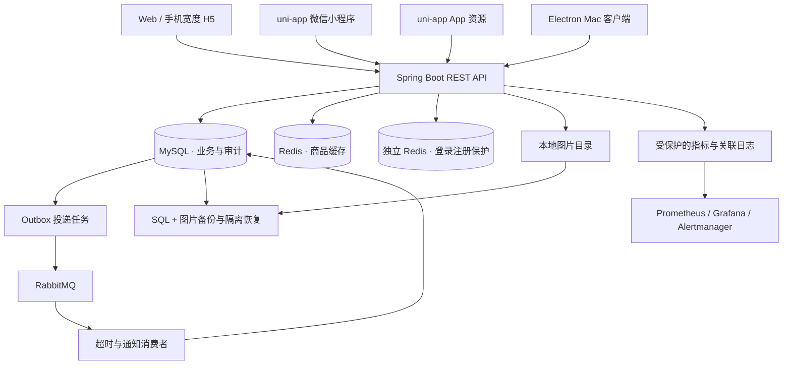

# 技术结构与源码导航

这是单体 Spring Boot 服务与多端客户端组成的项目。业务模块在同一服务中按领域组织，使用 Spring JDBC 访问 MySQL；没有把它描述成微服务、MyBatis、JPA 或 JWT 项目。

## 请求和数据怎样流转

App 节点表示已编译的资源代码，尚未完成原生安装包和真机发布验收；小程序也尚未公开发布。SMTP、真实支付和对象存储属于需要外部配置或继续接入的能力。

## 前端

| 入口 | 关注点 |
| --- | --- |
| [首页](../campus-market-client/pages/index/index.vue) | 响应式布局、搜索与分类、发布面板、快捷滚动 |
| [商品详情](../campus-market-client/pages/product/detail.vue) | 商品图文、卖家、购买意向与订单入口 |
| [组件](../campus-market-client/components/) | 卡片、图库、资料字段、售后提醒和质量检查 |
| [API 层](../campus-market-client/api/) | HTTP 请求、会话与错误映射 |
| [状态处理](../campus-market-client/utils/) | 并发请求、草稿、分页、版本冲突与平台差异 |
| [服务地址](../campus-market-client/config/server.js) | 开发工具/真机/正式环境分别解析地址 |
| [页面配置](../campus-market-client/pages.json) | 当前 50 个页面路由 |
| [前端工具与测试](../campus-market-client/tools/) | Node 逻辑测试、编译清单、构建结果核验 |

## 后端

基础目录：`campus-market-server/src/main/java/com/campus/market/`。

| 模块 | 源码入口 | 实现内容 |
| --- | --- | --- |
| 身份与权限 | [auth](../campus-market-server/src/main/java/com/campus/market/auth/)、[admin](../campus-market-server/src/main/java/com/campus/market/admin/) | 会话、改密/恢复、邮件绑定、登录/注册保护与 ADMIN 校验 |
| 商品 | [product](../campus-market-server/src/main/java/com/campus/market/product/) | 参数校验、归属与版本、缓存、分页、质量检查与巡查 |
| 订单 | [order](../campus-market-server/src/main/java/com/campus/market/order/) | 状态流转、快照、幂等、超时补偿、售后与评价 |
| 消息 | [订单 MQ](../campus-market-server/src/main/java/com/campus/market/order/mq/)、[notification](../campus-market-server/src/main/java/com/campus/market/notification/) | Outbox、发布确认、租约、重试和消费去重 |
| 图片与治理 | [media](../campus-market-server/src/main/java/com/campus/market/media/)、[governance](../campus-market-server/src/main/java/com/campus/market/governance/) | 配额、引用保护、回收站、内容限制与审计 |
| 数据迁移 | [DatabaseMigrate](../campus-market-server/src/main/java/com/campus/market/migration/DatabaseMigrate.java) | 与应用运行进程分离的生产迁移入口 |

数据库访问使用 `JdbcTemplate` 和显式 SQL。关键写操作由服务层事务组织，数据库唯一键、外键、CHECK 与版本字段共同约束数据。具体业务测试见 [src/test](../campus-market-server/src/test/)。

## 数据库与运维

- [Flyway 迁移](../campus-market-server/src/main/resources/db/migration/)：42 份版本迁移，最新 V136；私有演练生成 45 张表（含迁移历史）。
- [数据库成熟度文档](../campus-market-server/docs/database-maturity.md)：支付尝试/退款执行证据/借贷分录/对账/结算模型、权限分离、备份恢复和保留策略。
- [数据库运维工具](../campus-market-server/scripts/)：`database_accounts.py`、`database_backup.py`、`database_retention.py`、`database_reconcile.py`、`database_benchmark.py`。
- [production 配置](../campus-market-server/src/main/resources/application-production.properties)：私有监听、关闭模拟支付、独立迁移、UTC 连接与环境保护。
- [监控配置](../campus-market-server/monitoring/)：业务指标、面板与告警模板；本地工具不会把监控凭据提交 Git。

## 桌面端与工程检查

Electron 主进程与本地静态服务位于 [desktop/src](../campus-market-desktop/src/)。渲染页没有 Node 权限，启用隔离与沙箱，对导航和网络目标做限制；Mac 包不包含后端和数据库。

根目录 [.github/workflows](../.github/workflows/) 包含三类 CI。GitHub 上的完整检查运行隔离后端回归和服务端打包；HBuilderX 多端编译需要配置了编译器的本地发布主机，不能把云端 Java 测试当成手机真机验收。

更多记录：[本地运行](GETTING_STARTED.md) · [验证范围](VERIFICATION.md) · [截图索引](SHOWCASE.md)
