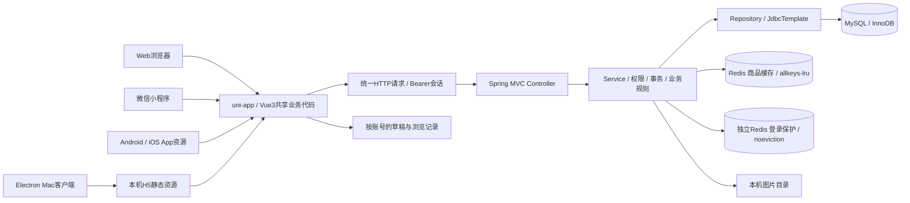

# 技术栈与架构

[返回项目首页](../README.md) · [启动指南](GETTING_STARTED.md) · [验证方式](VERIFICATION.md)

## 技术栈一览

| 范围 | 技术 | 落地方式 |
|---|---|---|
| 共享客户端 | Vue 3（当前依赖3.4.21）、uni-app、JavaScript | Composition API、组件复用、生命周期与条件编译 |
| 请求与状态 | uni.request、Vue ref/computed/watch | 统一错误处理、内存会话、账号/页面/请求序号校验 |
| HTTP服务 | Java 17、Spring Boot4.1.1、Spring MVC | REST接口、分层服务、统一异常、参数及权限验证 |
| 数据访问 | JdbcTemplate、MySQL InnoDB（当前本机9.6.0） | 参数绑定、行锁、事务、版本条件更新、唯一键 |
| 缓存与限流 | Spring Data Redis、Lettuce、Redis Lua | 商品版本缓存；独立登录保护实例、并发占位与TTL |
| 认证 | Spring Security Crypto的BCrypt、随机Bearer会话 | BCrypt强度12；会话摘要持久化、有效期与退出撤销 |
| 统计与分页 | SQL EXISTS、LEFT JOIN、GROUP BY、MAX/COUNT/SUM | 过滤后排序分页；当前页批量元数据与全局独立统计 |
| 文件处理 | Spring Multipart、图片格式/尺寸校验、本机文件存储 | 封面最大5MB，限制图片宽高；数据库保存文件元数据 |
| 桌面 | Electron44.7.0、@electron/packager20.3.0 | Mac ARM64、本机静态服务、隔离的渲染进程 |
| 验证 | JUnit Jupiter、MockMvc、Mockito、Node Test Runner | 真实临时MySQL集成、前端模拟状态、构建产物和桌面测试 |
| 工具 | Maven、HBuilderX、Node.js22.12+、Python3、Git | 依赖管理、跨端编译、隔离验证与源码/产物清单 |

认证使用服务端随机会话；上述Spring Security Crypto用于密码哈希，未接入完整Spring Security过滤器链。前端API和Controller是接口契约的源码依据。

## 架构

App节点表示可编译资源，完整安装包与手机验收仍待完成。Electron加载H5构建，Java/MySQL仍是独立服务，不会随桌面应用自动安装。

## 数据与一致性

- 用户与会话分表，原始Bearer Token保留于客户端内存；服务端保存摘要并检查有效期。刷新页面后重新登录。
- 商品使用整数分保存金额，支持卖家、封面、分类、状态、版本号。旧版本修改不能覆盖新状态。
- 收藏、公开留言、发布记录、草稿备份各自保留账号/商品归属。
- 购买意向保存商品标题、价格、版本快照，保留买卖双方与状态历史。卖家接受意向不自动标记商品已售。
- 意向内留言保存提交标识与撤回状态；个人阅读游标单独保存并只前进，查询不自动修改游标。
- 最近接收时间以当前账号收到、未撤回留言的MAX(created_at)计算，已读留言也参与。排序SQL与显示批次采用同一定义。

分页和本页时间在同一只读事务里取得。其他HTTP请求各有查询快照；跨请求同时发生新消息或撤回时，需要刷新更新结果，尚未实现游标分页或实时推送。

## 订单与Redis

订单状态为PENDING_PAYMENT、PAID、DELIVERED、COMPLETED、CANCELLED、CLOSED_TIMEOUT。下单保持商品在售但独立占用，付款标记商品已售；未付款取消或超时释放占用。数据库生成15分钟付款截止时间，定时任务分批关闭；付款/取消请求也检查超时。

状态更新、商品版本变更和操作记录同事务，提交后失效商品缓存。商品→订单固定加锁顺序，条件更新与唯一有效订单约束配合；重放在追加事件前返回。订单详情与记录、筛选列表与角色全量统计分别使用同一REPEATABLE_READ快照。完成金额仅汇总已完成模拟订单的整数分快照，不是账户余额或真实收入。

商品缓存只保存公开正文，按ID/版本选键，TTL基础60秒并附加抖动。每次仍向MySQL核实当前状态/版本及昵称/收藏等动态信息，缓存故障回退；没有零SQL或吞吐提升倍数声明。

登录保护使用另一个Redis实例（默认6380/noeviction），与6379/allkeys-lru商品缓存分离。Lua原子检查来源与账号额度并占位，密码核验完成后按随机票据处理；限流429附Retry-After，保护服务失败503且不签发新会话。Lua执行错误不保证自动回滚先前脚本写入，未持久化Redis重启会重新开始窗口。

说明：[商品缓存](../campus-market-server/REDIS.md)、[登录保护](../campus-market-server/LOGIN_PROTECTION.md)、[订单生命周期](../campus-market-server/ORDER_LIFECYCLE.md)、[交付/收货](../campus-market-server/ORDER_FULFILLMENT.md)、[统计](../campus-market-server/ORDER_QUERY.md)、[操作记录](../campus-market-server/ORDER_EVENTS.md)。

## 实现索引

| 设计点 | 可以直接阅读的源码 |
|---|---|
| 订单事务、幂等与超时 | [OrderService](../campus-market-server/src/main/java/com/campus/market/order/OrderService.java)、[OrderTimeoutSweep](../campus-market-server/src/main/java/com/campus/market/order/OrderTimeoutSweep.java) |
| 订单记录与统计 | [OrderRepository](../campus-market-server/src/main/java/com/campus/market/order/OrderRepository.java)、[时间线校验](../campus-market-client/utils/order-timeline.js)、[详情页](../campus-market-client/pages/order/detail.vue) |
| Redis商品缓存 | [ProductDetailCache](../campus-market-server/src/main/java/com/campus/market/product/ProductDetailCache.java) |
| Redis登录限流 | [登录保护说明与脚本入口](../campus-market-server/LOGIN_PROTECTION.md)、[预占Lua](../campus-market-server/src/main/resources/redis/login-reserve.lua)、[完成Lua](../campus-market-server/src/main/resources/redis/login-finish.lua) |
| 商品版本冲突与权限 | [ProductService](../campus-market-server/src/main/java/com/campus/market/product/ProductService.java)、[ProductRepository](../campus-market-server/src/main/java/com/campus/market/product/ProductRepository.java) |
| 发布幂等 | [PublicationService](../campus-market-server/src/main/java/com/campus/market/publication/PublicationService.java)、[表结构](../campus-market-server/sql/lesson38-product-publications.sql) |
| 购买意向状态与行锁 | [PurchaseIntentService](../campus-market-server/src/main/java/com/campus/market/intent/PurchaseIntentService.java)、[Repository](../campus-market-server/src/main/java/com/campus/market/intent/PurchaseIntentRepository.java) |
| 留言幂等与撤回 | [PurchaseIntentMessageService](../campus-market-server/src/main/java/com/campus/market/intent/PurchaseIntentMessageService.java)、[Repository](../campus-market-server/src/main/java/com/campus/market/intent/PurchaseIntentMessageRepository.java) |
| 未读聚合 | [PurchaseIntentUnreadRepository](../campus-market-server/src/main/java/com/campus/market/intent/PurchaseIntentUnreadRepository.java) |
| 最近收到排序与批量时间 | [排序枚举](../campus-market-server/src/main/java/com/campus/market/intent/PurchaseIntentSort.java)、[Repository](../campus-market-server/src/main/java/com/campus/market/intent/PurchaseIntentRepository.java) |
| 会话及密码哈希 | [SessionService](../campus-market-server/src/main/java/com/campus/market/auth/SessionService.java)、[PasswordConfig](../campus-market-server/src/main/java/com/campus/market/config/PasswordConfig.java) |
| 前端异步失效与结果提交 | [PurchaseIntentList.vue](../campus-market-client/components/PurchaseIntentList.vue)、[request.js](../campus-market-client/api/request.js) |
| 跨端编译与哈希校验 | [build.mjs](../campus-market-client/tools/build.mjs)、[build-check.mjs](../campus-market-client/tools/build-check.mjs) |
| 桌面服务、窗口及权限 | [local-server.mjs](../campus-market-desktop/src/local-server.mjs)、[window-policy.mjs](../campus-market-desktop/src/window-policy.mjs) |

## 当前边界

当前包括正式订单状态机与有效订单占用，支付为模拟流程。真实支付/结算、退款售后、WebSocket推送、容器化部署、线上性能压测及Android/iOS安装包仍待完成。事件在应用层只追加，数据库管理员可修改，删除订单会级联删除事件，不能称为不可篡改审计。
